# Koe

A small "Support" button in the corner of your app. Your users report a bug, suggest an idea and vote on other people's ideas without leaving the page.

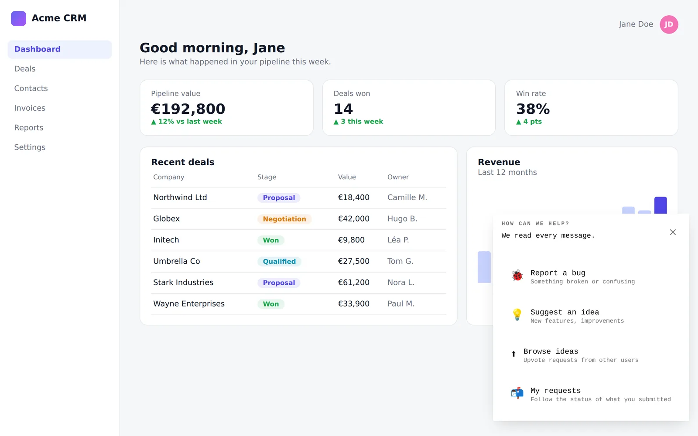

  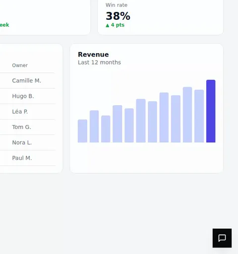

## Report a bug in thirty seconds

A title, what happened, how to reproduce it. Koe attaches the page, the browser and the app version on its own. No more asking "which screen were you on?".

  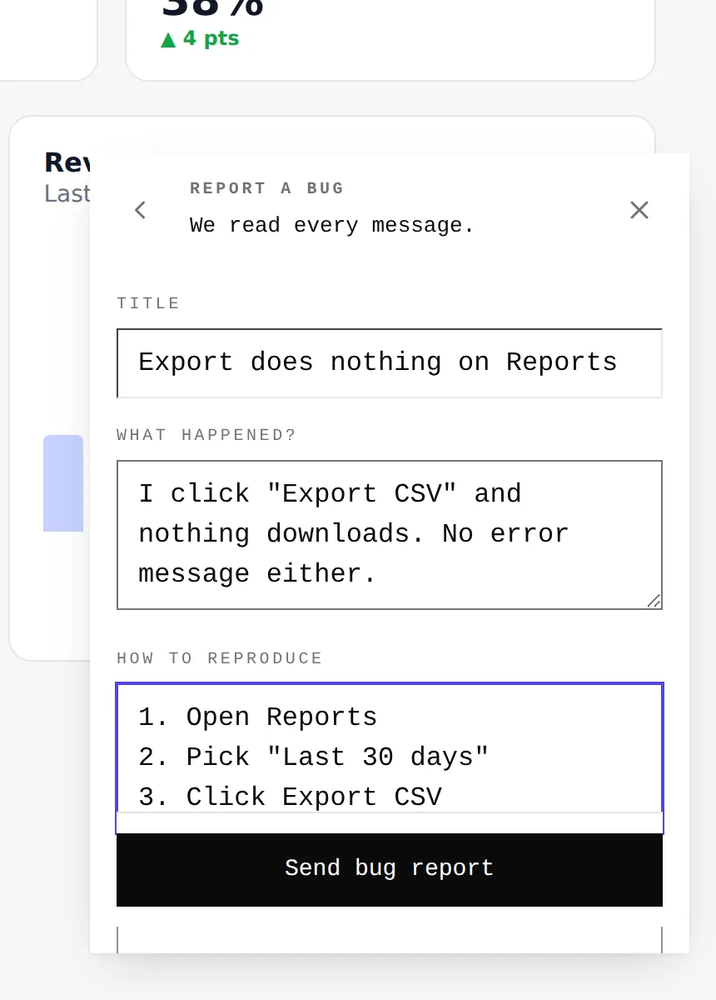

## Let your users pick what comes next

Anyone can suggest an idea and upvote the others. The most wanted ones rise to the top, so you know what to build next.

<table>
  <tr>
    <td>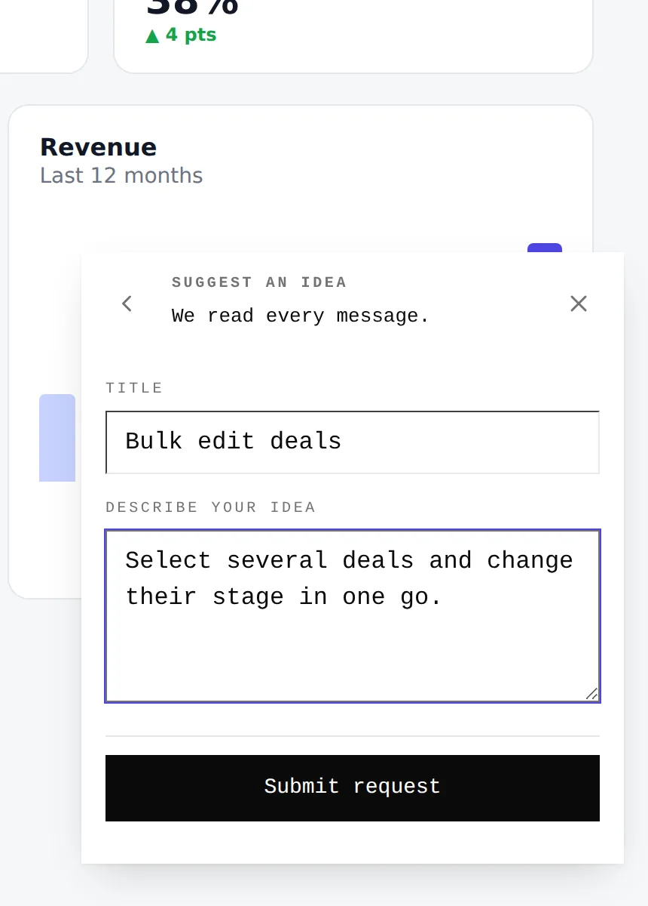</td>
    <td>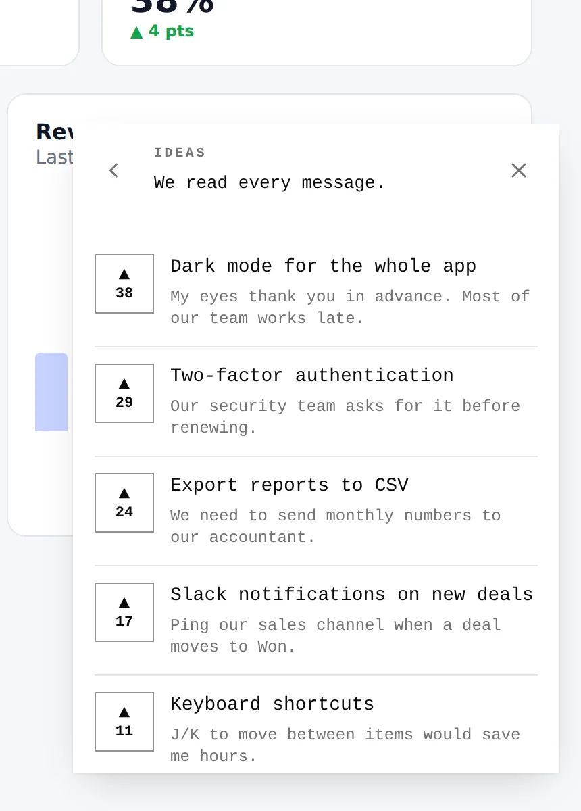</td>
  </tr>
</table>

## Keep everyone in the loop

Under "My requests", each user finds everything they sent, with its current status: open, planned, in progress, shipped. Nobody has to email support to ask where things stand.

  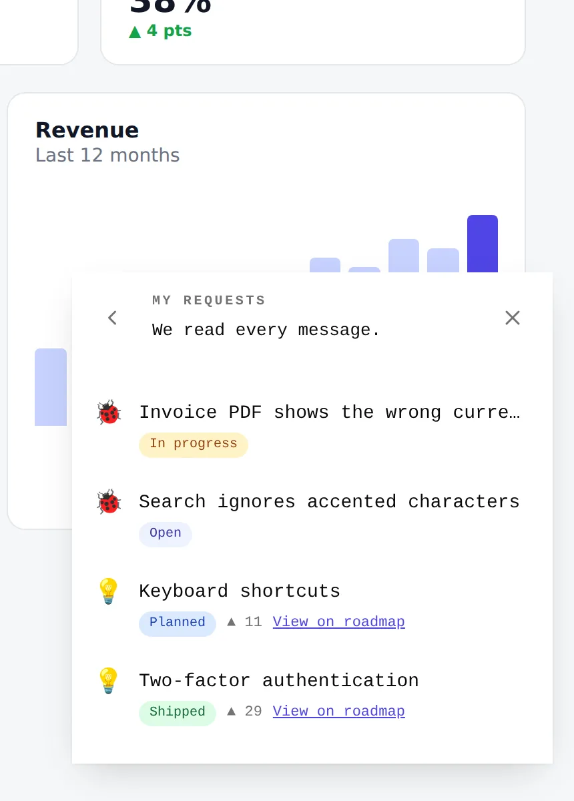

## Share a public roadmap

You pick which tickets go public. Koe turns them into a page you can share: planned, in progress, shipped.

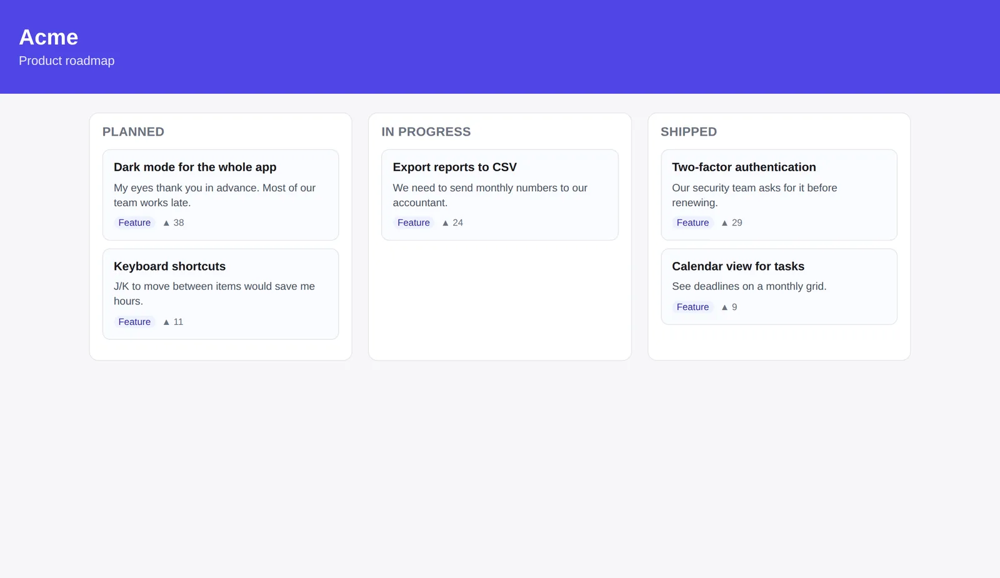

## Triage from a single inbox

Bugs and ideas land in the same place. Filter them, change their status and priority, keep private notes. Every change stays in the history and can be undone.

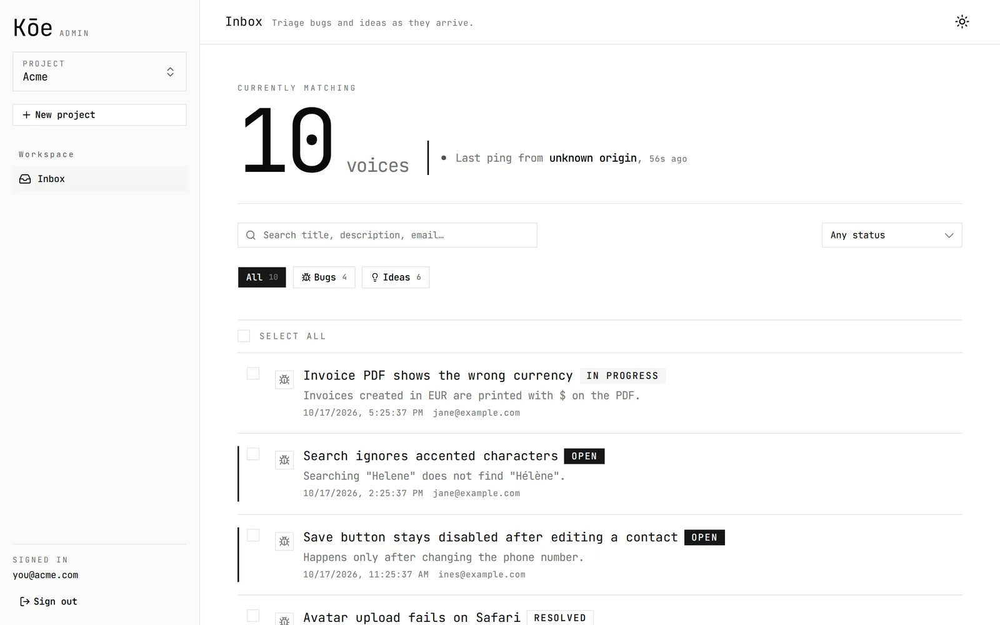

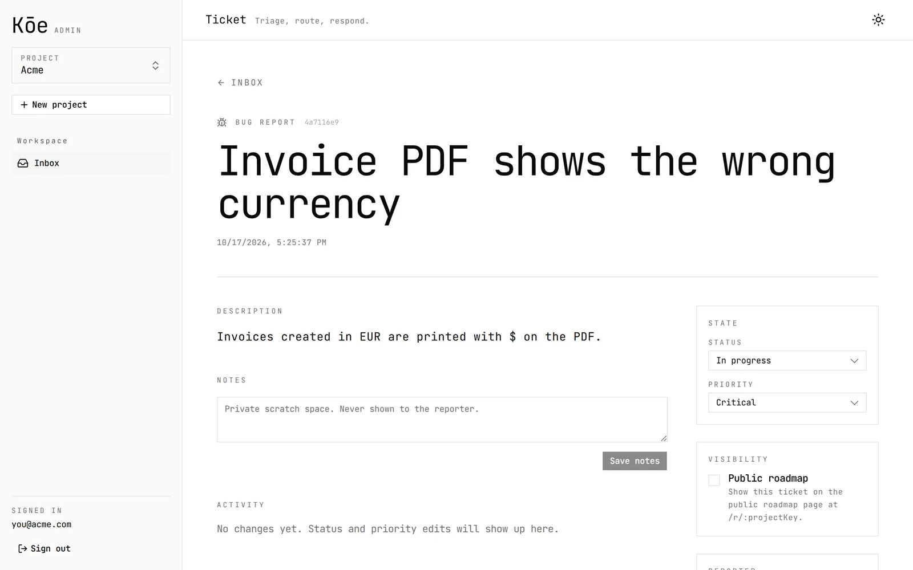

## Your server, your colors

The widget follows light or dark mode, takes your accent color and slides up from the bottom of the screen on mobile. One Koe instance can serve several apps.

<table>
  <tr>
    <td>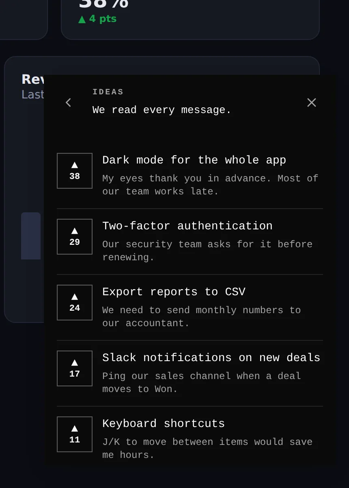</td>
    <td>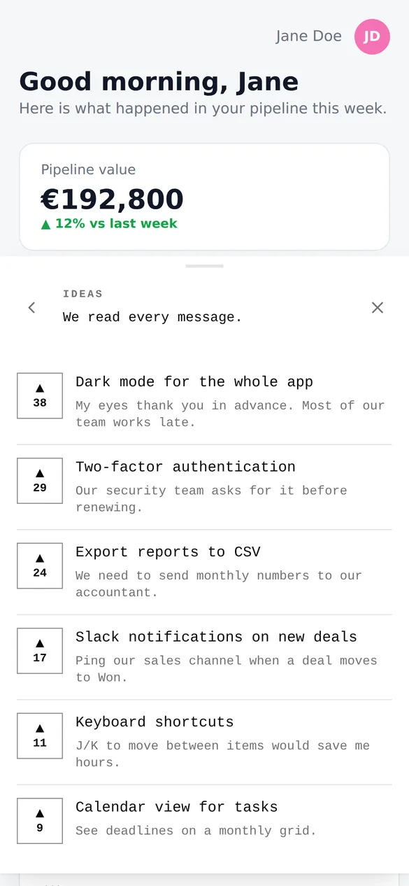</td>
  </tr>
</table>

Koe is self-hosted: your users' feedback stays on your servers. No subscription, no managed instance.

## Try Koe

The [install and integration guide](docs/installation.md) (in French) shows how to run your own instance and add the widget to your app. Want to contribute? Read [CONTRIBUTING.md](CONTRIBUTING.md).

MIT license.
